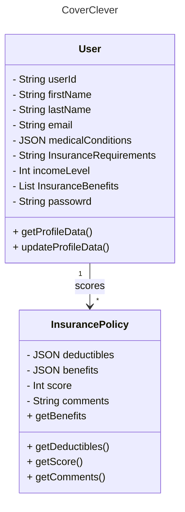

# CoverClever
CoverClever is a browser extension that: Scans users' insurance policies, summarizes them, provides a score based on user preferences obtained at profile setup, and includes a chatbot to answer questions about coverage details. Insurers its focuses on are: United Health Care, Blue Cross Blue Shield, and Ambetter.

CoverClever simplifies health insurance coverage, empowering you to confidently navigate your plan, understand your benefits, and claim what you’re entitled to. Say goodbye to confusion and hello to transparency. CoverClever makes health insurance work for you—so you can focus on your health, not the fine print.

# 👥 Contributors
	•	Kavin Jha – jha.kav@northeastern.edu
	•	Calvin Shi – cs.calvin.shi@gmail.com
	•	Chaitanya Agarwal – chaitanyaagarwalwork@gmail.com
	•	Dany Sigha – nohonetdany@gmail.com

# ❗ Problem Statement

Understanding health insurance coverage can be overwhelming. Most of us have faced the daunting task of navigating a 100+ page insurance document, only to give up in frustration. This lack of clarity leaves us unsure about what is actually covered by our insurance—and at the end of the day, we’re paying for this service.

# ✨ Key Features

1. Identifies what co-pays are required in your plan so you can budget for healthcare with ease
2. Provides insights and an insurance score based on your unique needs, thanks to our AI-powered analysis and personalized preference algorithm
3. Summarizes your health insurance policies and makes a chatbot available to answer questions about them

# 🛠️ Technology Stack

    Frontend:
        •	React.js (with Redux for state management)
        •	Material UI for modern and responsive styling
        •	Vite to bundle and optimize code
        •	SASS for efficient styling

    Backend:
        •	Node.js & Express.js
        •   MongoDB for database management

    APIs
        •	WebExtensions API (for modern browsers like Chrome, Edge, Firefox, and Opera)

    AI
        •	Tool #1
        •	Tool #2
        •	Tool #3

# 🏗️ System Architecture

WORK IN PROGRESS

# Object model

# 📖 API Documentation

WORK IN PROGRESS

# 📖 Usage Guide

WORK IN PROGRESS